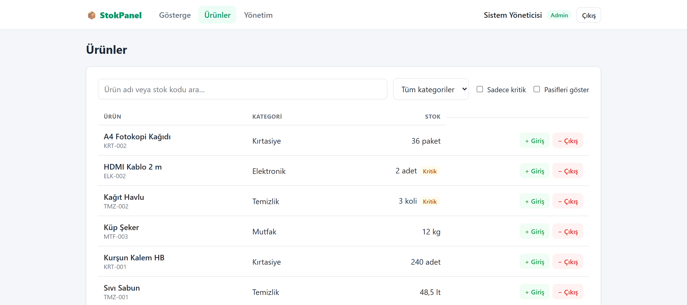
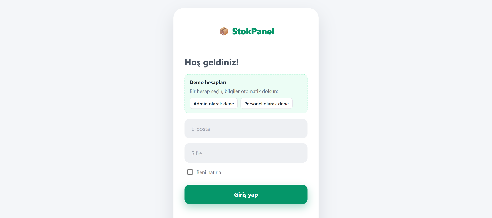
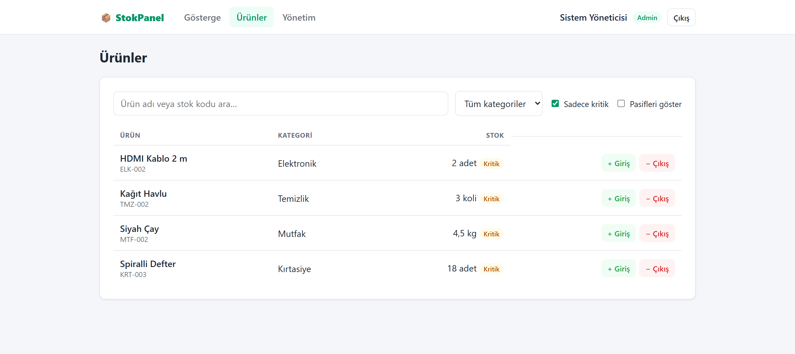
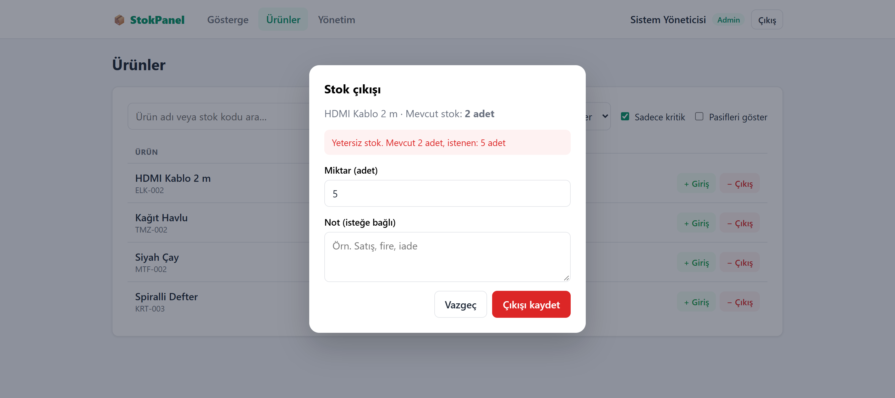
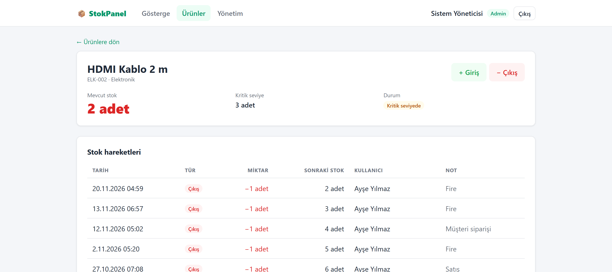
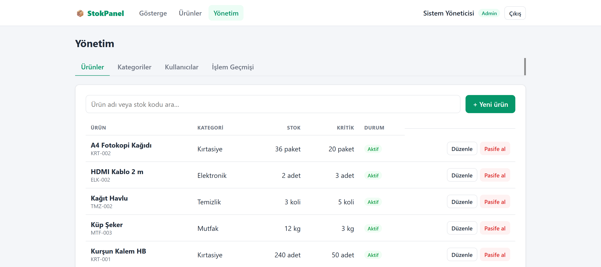
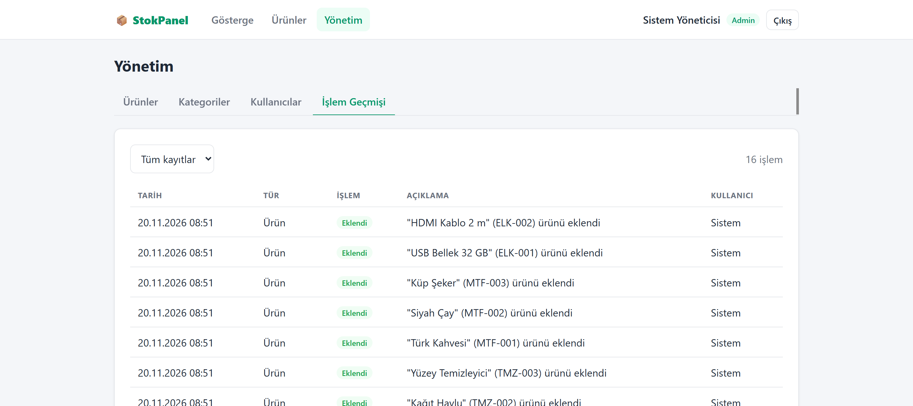
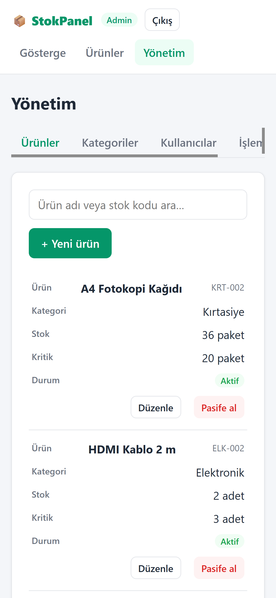

# 📦 StokPanel

Küçük ve orta ölçekli işletmeler için **web tabanlı stok takip paneli**. Ürünler, kategoriler, stok giriş-çıkışları, kritik stok uyarıları, rol bazlı yetkilendirme ve işlem geçmişi tek bir uygulamada.

> **Canlı demo:** _yakında_ · Demo hesapları için [aşağıya](#demo-hesapları) bakın.



## Özellikler

**Personel**
- Ürünleri arama, kategoriye ve kritik stoka göre filtreleme (filtreler adres çubuğunda saklanır, link olarak paylaşılabilir)
- Stok girişi ve çıkışı (miktar + not); stok asla eksiye düşmez
- Ürün bazında hareket geçmişi: kim, ne zaman, ne kadar, sonraki stok
- Gösterge: aktif ürün sayısı, kritik stok, bugünkü giriş/çıkış, son hareketler

**Admin**
- Kategori ve ürün yönetimi (ekleme, düzenleme, pasife alma)
- Kullanıcı rolleri (Admin / Personel)
- İşlem geçmişi: tüm değişiklikler kullanıcı ve zamanla otomatik kaydedilir
- Kritik işlemlerden önce onay diyaloğu

**Genel**
- Kayıt / giriş, cookie tabanlı güvenli oturum, 5 hatalı denemede geçici kilit
- Mobil uyumlu arayüz (tablolar telefonda karta dönüşür)
- Tamamen Türkçe arayüz ve hata mesajları

## Teknolojiler

| Katman | Teknoloji |
|---|---|
| Backend | .NET 10, ASP.NET Core Minimal API, Entity Framework Core 10 |
| Veritabanı | Microsoft SQL Server |
| Kimlik | ASP.NET Core Identity (cookie, roller, lockout) |
| Frontend | React 19, TypeScript, Vite, React Router |
| Test | xUnit (Domain katmanı) |

## Mimari

**Clean Architecture** + **Vertical Slice** + **DDD** + **olay güdümlü işlem geçmişi**

```
Api  ──►  Application  ──►  Domain
 │             ▲
 └──►  Infrastructure ─┘
```

| Katman | Sorumluluk |
|---|---|
| **Domain** | Varlıklar ve iş kuralları (Category, Product, StockMovement). Hiçbir pakete bağımlı değil. |
| **Application** | Kullanım senaryoları (`Features/` altında her özellik kendi dosyasında) |
| **Infrastructure** | EF Core, Identity, işlem geçmişi |
| **Api** | HTTP uçları, yetkilendirme, hata yönetimi; derlenmiş React'ı da sunar |

### Öne çıkan teknik kararlar

- **Stok değiştirmenin tek kapısı:** `Product.AddStock/RemoveStock` metotları `internal`. Stok yalnızca `StockMovement.CreateIn/CreateOut` ile değişir; hareket kaydı olmadan stok değişmesi derleyici seviyesinde imkânsız.
- **Eşzamanlılık koruması:** İki kullanıcı aynı anda aynı ürüne çıkış yaparsa ikincisi `409 Conflict` alır (EF Core concurrency token). Stok yarış durumunda eksiye düşmez.
- **Domain event → işlem geçmişi:** Varlıklar olay üretir (`ProductCreatedEvent` vb.), `SaveChangesAsync` bunları işlem kaydına çevirir. Değişiklik ve log **aynı transaction'da** yazılır.
- **Merkezi hata yönetimi:** `IExceptionHandler` ile iş kuralı ihlali → 400, bulunamadı → 404, çakışma → 409.
- **UTC saklama, yerel gösterme:** Tüm tarihler UTC saklanır, arayüzde Türkiye saatine çevrilir.
- **Tek uygulama yayını:** React derlenip `wwwroot`'a konur; API ve arayüz tek adresten sunulur.

## Ekran görüntüleri

| | |
|---|---|
|  |  |
|  |  |
|  |  |



## Kurulum

**Gereksinimler:** .NET 10 SDK, Node.js 22+, SQL Server veya LocalDB (Visual Studio ile gelir)

```bash
git clone https://github.com/balselver/StokPanel.git
cd StokPanel
```

**1. Ayarlar (User Secrets)**

```bash
cd backend/src/StokPanel.Api
dotnet user-secrets set "Seed:AdminEmail" "admin@stokpanel.local"
dotnet user-secrets set "Seed:AdminPassword" "Demo1234"
dotnet user-secrets set "Seed:DemoData" "true"
dotnet user-secrets set "Seed:DemoPassword" "Demo1234"
```

Bağlantı dizesi `appsettings.Development.json` içinde LocalDB'yi gösterir. Farklı bir SQL Server için `ConnectionStrings:Default` değerini değiştirin.

**2. Tek uygulama olarak çalıştırma**

```bash
cd frontend
npm install
npm run build          # React → backend/src/StokPanel.Api/wwwroot

cd ../backend/src/StokPanel.Api
dotnet run --launch-profile http
```

`http://localhost:5141` adresini açın. Veritabanı, roller, admin ve demo verisi ilk açılışta otomatik oluşur.

**Geliştirme modu:** Backend çalışırken ayrı bir terminalde `cd frontend && npm run dev` → `http://localhost:5173` (değişiklikler anında yansır).

## Demo hesapları

| Rol | E-posta | Şifre |
|---|---|---|
| Admin | admin@stokpanel.local | Demo1234 |
| Personel | personel@stokpanel.local | Demo1234 |

## Testler

```bash
cd backend
dotnet test
```

## Proje yapısı

```
StokPanel/
├── backend/
│   ├── src/
│   │   ├── StokPanel.Domain/          Varlıklar, iş kuralları, domain event'ler
│   │   ├── StokPanel.Application/     Kullanım senaryoları (Features/*)
│   │   ├── StokPanel.Infrastructure/  EF Core, Identity, migration'lar, seed
│   │   └── StokPanel.Api/             Minimal API uçları, Program.cs
│   └── tests/StokPanel.Domain.Tests/
├── frontend/src/
│   ├── api/          Tek API istemcisi (cookie, hata, oturum düşmesi)
│   ├── components/   Layout, Modal, onay diyaloğu
│   ├── hooks/        useApiData, useDebouncedValue
│   └── features/     auth, dashboard, products, admin
└── docs/screenshots/
```

## Yol haritası

- [ ] Excel'e aktarma (ürün listesi, hareketler)
- [ ] Şifremi unuttum (e-posta ile)
- [ ] Tedarikçi ve sipariş takibi
- [ ] Barkod ile ürün arama

## Lisans

MIT
